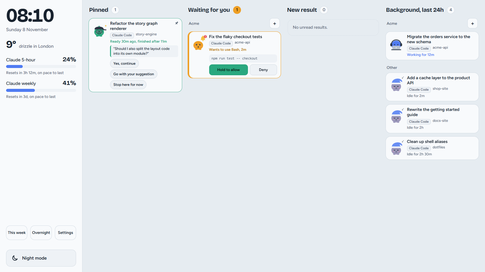

<p align="center">
  
</p>

<h1 align="center">LLM Deck</h1>

<p align="center">
  <strong>A touch dashboard for everything your AI tools are doing.</strong><br>
  Claude Code sessions, Claude and ChatGPT chats, and Codex threads on one screen,<br>
  each with a little mascot that tells you its state at a glance.
</p>

<p align="center">
  <a href="https://github.com/aapostoliadis/llm-deck/actions/workflows/ci.yml"></a>
  
  
  
  
  <a href="LICENSE"></a>
</p>

<p align="center">
  <picture>
    <source media="(prefers-color-scheme: dark)" srcset="docs/screenshot-dark.png">
    
  </picture>
</p>

## Why

When several AI sessions run at once, you end up clicking through windows to see which one finished
and which one is waiting for you. LLM Deck was built for a small touch screen under the main monitor:
one glance shows what every session is doing, and one tap takes you straight to it.

## The mascots

<p align="center">
  
</p>

| Mascot | State | When |
|---|---|---|
| Headphones and a laptop | **Working** | A session is running, or a chat is writing its reply |
| A bell | **Waiting for you** | A permission request or a question needs your answer |
| Glasses and a cap | **New result** | Work finished while you were elsewhere |
| A nightcap | **Idle** | Nothing happening |
| A bandage | **Failed** | A session ended on an error |

## Features

- 🗂️ **Four columns**: Pinned, Waiting for you, New result and Background, grouped by project.
- 👆 **One tap** opens that exact session, chat or thread in its own app.
- 👀 **Double-tap** a Claude Code or Codex card to read its last reply without switching windows.
- ✅ **Hold to allow, tap to deny** safe permission requests right on the card. Allow needs a one-second press, so a stray tap can't approve anything. Risky requests (deletes, pushes, sending, publishing) always go to the app.
- 💬 **Quick replies** such as "Yes, continue", typed into the right conversation for you.
- 📈 **Usage limits** for Claude and Codex, with a forecast under each bar of when you'd hit it at the current pace.
- 🔔 **A soft chime** when something needs you, a reminder if it waits too long, and quiet hours.
- 🌙 **Night mode and dimming** on a schedule, with a gentle shift to protect the screen.
- 📅 **This week** shows time, sessions and finished turns per project, and warns when a weekly limit won't last until it resets, naming the day and time it would run out. **Overnight** lists what finished, ran or got stuck while you were away.
- 🧭 **Project groups**, with suggestions based on your recent work.
- 📱 **Phone access** on the same Wi-Fi through a private link.
- 💾 **Backups**, a built-in **self-test**, and a watchdog that restarts the deck if it stops.

## Gestures

| Gesture | On a card |
|---|---|
| Tap | Open the session, chat or thread |
| Double-tap | Peek at the last reply (Claude Code and Codex) |
| Press and hold | Pin or unpin its project |
| Hold **Allow** for a second | Approve a safe permission request (tap **Deny** to refuse) |
| Swipe a result | Mark it as seen |
| Swipe an idle card | Hide it (Settings brings hidden cards back) |
| Tap a project heading | Show only that project; tap again for everything |
| Tap **+** on a heading | Start a new Claude Code session for that project |

Press **F11** to switch the deck between full screen and a window.

## Requirements

- Windows 10 or 11, or macOS 13 or newer (see [Windows and macOS](#windows-and-macos)). The core dashboard also runs on Linux.
- [Node.js](https://nodejs.org) 22.5 or newer.
- [Claude Code](https://docs.claude.com/en/docs/claude-code/overview).
- Optional: the Claude, ChatGPT and Codex desktop apps, and Microsoft Edge or Google Chrome for the full-screen window.

## Install

```
git clone https://github.com/aapostoliadis/llm-deck.git
cd llm-deck
node install.js
```

The installer copies the program to `~/.claude-deck` (`%USERPROFILE%\.claude-deck` on Windows), registers the
Claude Code hooks (saving a backup of your Claude Code settings first), sets the deck to start at login, and starts it.
On Windows it creates **LLM Deck** shortcuts on the desktop and in Startup; on macOS it adds login agents and an
**LLM Deck** app in `~/Applications`. The deck opens full screen on the smaller of your displays.

To update, pull the latest version and run `node install.js` again. Your settings are kept.

### On macOS

Two features need a permission that only you can grant. Open **System Settings › Privacy & Security** and add
the Node.js program (run `which node` in Terminal to find it) to:

- **Full Disk Access**, so the deck can read Notification Center and show Claude chats that finish in the background.
- **Accessibility**, so the deck can type quick replies into Claude Code and Codex.

Then restart the deck so it picks up the new permissions:

```
launchctl kickstart -k gui/$(id -u)/com.llmdeck.server
```

Everything else works without them. To reopen the dashboard window at any time, open **LLM Deck** from
`~/Applications` or Spotlight.

Check that everything works:

```
node "%USERPROFILE%\.claude-deck\selfcheck.js"     # Windows
node ~/.claude-deck/selfcheck.js                   # macOS
```

## Windows and macOS

| Feature | Windows | macOS |
|---|---|---|
| Claude Code sessions, limits, peek, phone access, backups | ✓ | ✓ |
| Tap to open the exact Claude Code session or Codex thread | ✓ | ✓ |
| Hold to allow, tap to deny | ✓ | ✓ |
| Claude chats | From the app's sidebar and notifications | From notifications ¹ |
| ChatGPT chats | From the app's sidebar | Not yet |
| Quick replies | Claude Code, Codex, Claude and ChatGPT chats | Claude Code and Codex ² |
| Start at login | Startup shortcut and watchdog | Login agents (restarted automatically) |
| Warnings after app updates | ✓ | Version tracking only |

¹ Give **node** Full Disk Access in System Settings › Privacy & Security, so the deck can read Notification Center.  
² Give **node** Accessibility access in the same place, so the deck can type the reply.

Both platforms have been tested end to end, including on macOS: install and start at login, cards and tap to open,
Claude chat notifications and quick replies. If something doesn't work for you, please open an issue with the output
of the self-check.

## Settings

Everything adjustable is in the deck's **Settings** panel: project groups, quiet hours, quick replies,
permission buttons, the screen, phone access, backups and the self-test. Every setting and its default
is listed in [`defaults.js`](defaults.js); your own choices are saved in `config.json` in the install folder.

## Phone access

Switch on **Settings › Phone** and scan the QR code with your phone on the same Wi-Fi. If the phone
can't connect, Windows Firewall is blocking it: allow **Node.js** on **private** networks only, either
in the prompt Windows shows or in Windows Security › Firewall & network protection › Allow an app
through firewall, and make sure your Wi-Fi's network profile is set to Private. Keep the link to
yourself, since anyone with it on your network can approve requests.

## Privacy

Everything runs on your computer. The deck reads Claude Code's session files and hook events, Codex's
local thread records, the sidebars of the Claude and ChatGPT desktop apps through Windows UI Automation,
and the notifications those apps send to Windows. Nothing is sent anywhere; the only outside requests
are the weather ([Open-Meteo](https://open-meteo.com)) and the dashboard's fonts. Backups never include
the private phone link.

## Troubleshooting

| Problem | What to do |
|---|---|
| The phone can't connect | Allow Node.js through Windows Firewall on private networks, as described above. On macOS, allow incoming connections for node when asked. |
| No Claude chat cards on macOS | Give node Full Disk Access, then restart the deck. |
| Quick replies do nothing on macOS | Give node Accessibility access in System Settings › Privacy & Security. |
| Taps on the touch screen land on the other monitor | Search Start for **Calibrate the screen for pen or touch input**, choose **Setup** and tap the touch screen. |
| Chat cards stop updating after an app update | The left panel says so. Please open an issue with the app's version. |
| ChatGPT cards look out of date | The deck can only read ChatGPT while its window is open; minimised is fine. |
| Something else looks wrong | Run the self-check and **Settings › Run self-test**, then open an issue with the results. |

## Automated checks

Every push and pull request is checked on Windows, macOS and Linux, each with Node 22 and Node 24. A run checks every
JavaScript, shell and PowerShell file, installs the deck into a throwaway folder, starts the server, makes sure a
missing icon can't crash it, and runs the self-check. The **CI** badge at the top shows the latest result, and each
commit gets a tick or a cross.

To start a run by hand, open the **Actions** tab, choose **CI** and click **Run workflow**. To run the same checks on
your own computer, and for how to report a problem or propose a change, see [CONTRIBUTING.md](CONTRIBUTING.md).

## How it's built

| File | What it does |
|---|---|
| `server.js` | Local web server: gathers every source into cards and serves the dashboard |
| `hook.js`, `perm-hook.js` | Claude Code hooks for session events and permission requests |
| `codex.js` | Reads Codex threads and limits |
| `chat-watch.ps1`, `notif.js`, `notif-mac.js` | Read the Claude and ChatGPT desktop apps and their Windows or macOS notifications |
| `platform.js` | The few things that work differently on Windows, macOS and Linux |
| `focus-*.ps1`, `reply.ps1`, `reply-mac.applescript` | Open the right session or chat, and type quick replies |
| `extras.js`, `v3.js`, `suggest.js`, `backup.js` | Permissions, settings, phone access, group suggestions, backups |
| `watchdog.ps1`, `open-deck.ps1`, `start-deck.vbs`, `open-deck.sh` | Keep it running and open the full-screen window |
| `public/` | The dashboard itself: `index.html`, `deck.css`, `deck.js` and the icons |
| `selfcheck.js`, `defaults.js`, `install.js`, `install-mac.js` | Automated checks, default settings, installer |

## Uninstall

Delete the LLM Deck shortcuts (on macOS: `~/Applications/LLM Deck.app` and the two `com.llmdeck` files in
`~/Library/LaunchAgents`), remove the hook entries that mention `claude-deck` from your Claude Code
`settings.json` (or restore the `.before-llm-deck.bak` copy next to it), and delete the
`%USERPROFILE%\.claude-deck` folder.

## License

[MIT](LICENSE). You're free to use, change and share LLM Deck, including in your own projects.

## Notes

LLM Deck is an independent project, not affiliated with or endorsed by Anthropic or OpenAI. The Claude
and ChatGPT icons shown on cards are copied at install time from the apps already installed on your
computer and are not part of this repository.
